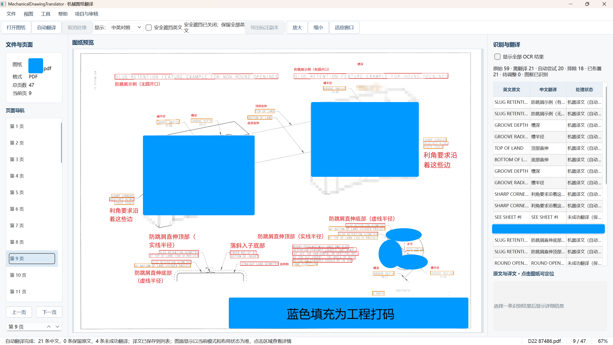
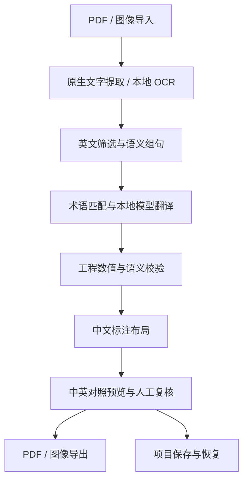

# 机械图纸英文翻译系统



基于 Python 与 PySide6 的本地桌面应用，面向机械图纸的英文识别、中文翻译、中英对照预览与中文标注导出。项目将 OCR、专业术语匹配、本地模型翻译、工程信息校验和图纸坐标布局串联为独立的服务与后台任务。

## 核心功能

- **PDF 与图像解析**：支持 PDF、JPG、PNG、BMP；优先提取 PDF 可见原生文字，并通过图像 OCR 处理扫描内容。
- **本地 OCR**：集成 RapidOCR 与 ONNX Runtime CPU，保存原始文字、边界框、页码和识别来源，支持有条件的局部复识别。
- **英文筛选与语义组句**：区分自然语言、工程标识和尺寸信息，处理同框分句、跨行分句及跨框组句，保留来源区域与字符跨度。
- **离线英中翻译**：集成 CTranslate2、SentencePiece 与 Argos en→zh 模型加载接口，结合机械术语匹配、短语规则及 D7/D8 翻译增强。
- **V2 知识检索接口**：实现词库清单校验、精确匹配、来源追踪、实例上下文校验及 Reviewed94 审核知识接入。
- **工程信息保护**：检查数字、小数、公差、单位、方向、否定与条件表达，对不符合规则的结果保留原英文并记录原因。
- **中英对照与人工复核**：提供英文原文、中英对照、译文编辑、项目保存恢复及任务状态展示。
- **中文标注与 PDF 导出**：基于原始图纸坐标生成中文布局，复用预览与导出布局模型，并按审核资格执行导出校验。

## 技术栈

| 层次 | 技术 |
| --- | --- |
| 桌面界面 | Python 3.11、PySide6 / Qt Widgets、QSS |
| OCR 推理 | RapidOCR、ONNX Runtime CPU |
| PDF 处理 | pdfplumber、pypdfium2、pypdf |
| 图像处理 | Pillow |
| 本地翻译 | CTranslate2、SentencePiece、Argos en→zh 1.9 |
| 任务调度 | Qt 信号槽、后台线程与服务工厂 |
| 知识与数据 | JSON 词库接口、来源记录、哈希校验、项目存储 |

固定版本见 [requirements.txt](requirements.txt)。

## 整体架构



`launch.py` 组合运行预设，`main.py` 解析参数、构造服务工厂与主窗口。OCR、翻译、预览和导出由独立后台任务执行，原始识别内容、译文与审核状态分别保存。

## OCR 与语义处理

`document_service.py` 管理文档载入；`ocr_service.py` 与 `rapidocr_engine.py` 组织原生文字提取和图像识别，保留文字及坐标证据。`ocr_refinement.py` 提供条件触发的局部复识别（OCR-3C）。

`translation_targets.py`、`source_text_policy.py` 与 `engineering_text.py` 筛选送译内容，`semantic_grouping.py` 根据空间关系和语义句界恢复送译单元（OCR-3B）。组合结果保留原区域关联，便于定位、复核及后续布局。

## 本地翻译与 V2 知识接口

`translation_backend.py` 负责本地模型加载与推理，`translation_service.py` 组织术语匹配、模型翻译、专业增强及安全回退。D7/D8、专业字段校验、短语记忆、收敛与 Argos Core 模块通过配置接入同一处理链路。

V2 接口由以下模块实现：

- `knowledge_v2.py`：知识结构、来源关联和匹配资格。
- `knowledge_v2_runtime.py`：运行包加载、清单校验和检索。
- `knowledge_v2_release.py`：可信清单指纹。
- `reviewed94.py`、`user_review_overlay.py`：审核知识与实例上下文校验。

运行资源采用相对路径组织。V2 运行包目录为 `mechanical_drawing_translator/resources/translation/knowledge_v2/`，数据合同包含 `manifest.json`、`runtime.json` 和 `reviewed94.json`；资源加载保留 schema、可信哈希与来源范围校验。各能力的启用方式由入口预设及服务配置决定。

## 工程信息保护

工程数值与符号在翻译前后进行一致性检查。`engineering_text.py`、`engineering_relations.py`、`engineering_character_verification.py` 及翻译增强模块检查工程 token、对象关系、方向、条件和否定表达。识别原文与模型输出分别保留，校验结果以来源和警告关联到对应区域。

## 界面、标注与导出

`main_window.py`、`panels.py`、`drawing_view.py` 与 `product_workflow.py` 实现文档浏览、图纸预览、翻译编辑及项目保存恢复。后台线程通过 Qt 信号槽返回结果与任务状态。

`annotation_layout.py`、`joint_annotation_layout.py` 和 `annotation_painter.py` 基于源坐标生成中文标注。产品提供英文原文与中英对照，默认中英对照；安全遮挡作为双语模式中的独立选项，默认关闭。

PDF 遮挡依据原生对象与背景证据执行，在输出副本上形成视觉覆盖并保留底层原文。`export_service.py` 与 `export_item_policy.py` 校验导出资格，PDF 标注通过字体嵌入与矢量覆盖层合并完成。

## 源码目录

```text
MechanicalDrawingTranslator/
├── main.py                         # 桌面应用入口
├── launch.py                       # 运行预设
├── requirements.txt                # 依赖版本
├── mechanical_drawing_translator/
│   ├── ocr_service.py              # OCR 流程
│   ├── rapidocr_engine.py          # RapidOCR 接口
│   ├── semantic_grouping.py        # 语义组句
│   ├── translation_service.py      # 翻译流程
│   ├── knowledge_v2_runtime.py      # V2 检索接口
│   ├── engineering_text.py         # 工程信息保护
│   ├── annotation_layout.py        # 中文布局
│   ├── export_service.py           # 导出服务
│   ├── main_window.py              # 主窗口
│   ├── styles.qss                  # 界面样式
│   └── resources/                  # 模型、字体来源与许可证文本
└── resources/licenses/             # 第三方许可与来源说明
```

正式包内还包含各服务的后台 Worker、工程关系校验、PDF 证据分析、审核接口、项目存储和恢复模块。

## 安装与运行资源配置

创建 Python 3.11 虚拟环境并安装依赖：

```powershell
python -m venv .venv
.\.venv\Scripts\python.exe -m pip install -r requirements.txt
```

本仓库分发业务源码、界面样式及第三方许可文本。运行资源独立配置，按下列相对目录放置具有合法使用权限且符合源码校验合同的资源：

| 包内 resources 路径 | 配置内容 |
| --- | --- |
| `models/ocr/` | RapidOCR ONNX 模型；名称及身份见该目录 `MODEL_LICENSES.md` |
| `models/translation/argos-en-zh-1.9/` | 模型清单、SentencePiece 分词模型与 CTranslate2 模型文件 |
| `fonts/` | NotoSansSC-Regular.otf；来源及 OFL 文本见同目录 |
| `translation/` | 基础术语、D7/D8 知识 JSON 与 V2 运行包 |

审核 overlay 通过项目相对路径 `data/user_review_overlays/` 配置。知识资源应与源码的 schema、可信清单指纹及审核范围保持一致。客户图纸和实例审核数据由使用者在本地管理，公开仓库保留对应接口实现。

配置运行资源后，通过产品预设启动：

```powershell
.\.venv\Scripts\python.exe launch.py --mode product
```

核心推理使用本地 CPU 服务。源码保留模型身份校验、知识来源追踪、人工审核与导出资格校验机制。

## 第三方来源

字体、OCR 模型、翻译模型及依赖的来源与许可文本随对应目录保留。各第三方组件适用其原有许可证；模型和字体采用独立资源配置方式。
